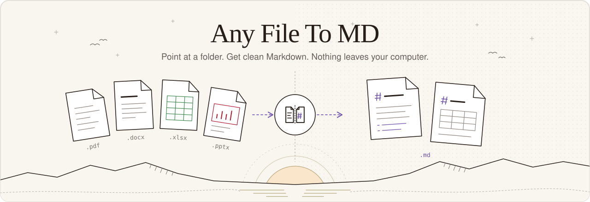
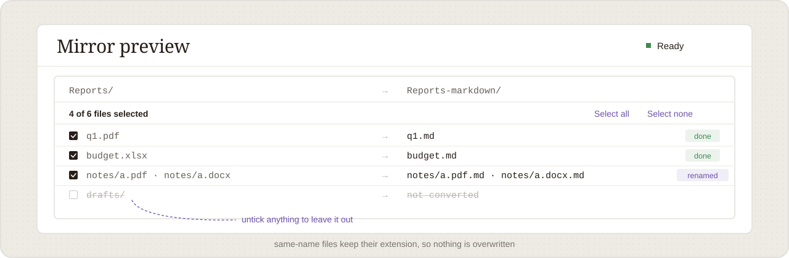
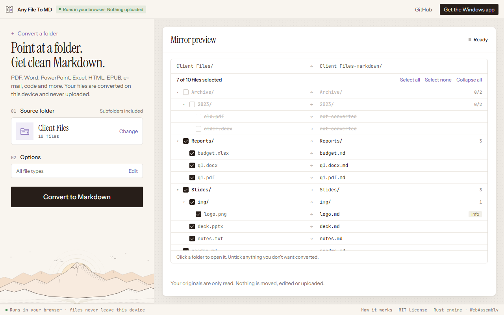
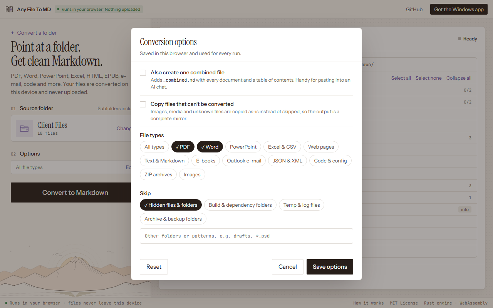

<p align="center">
  
</p>

<p align="center">
  <a href="https://github.com/pransharma2/Any-File-To-MD/releases/latest"></a>
  <a href="https://pransharma2.github.io/Any-File-To-MD/"></a>
  
  <a href="LICENSE"></a>
</p>

<p align="center">
  <b><a href="https://pransharma2.github.io/Any-File-To-MD/">Open the website</a></b>
  &nbsp;·&nbsp;
  <b><a href="https://github.com/pransharma2/Any-File-To-MD/releases/latest">Download for Windows</a></b>
  &nbsp;·&nbsp;
  <a href="#command-line">Command line</a>
</p>

<br>

Point it at a folder and you get a **mirrored folder of clean Markdown**, one `.md` per document, with the same subfolders. You can untick the files you don't want. Your originals are never touched.

Everything runs **on your own device**: no accounts, no uploads, no API keys. Even the website converts files inside your browser.

<br>

## Three ways to use it

<table>
  <tr>
    <td width="33%" valign="top">
      <br>
      <b>Website</b><br>
      <sub>Nothing to install. Works in Chrome, Edge, Firefox and Safari on any OS. Files are converted in your browser and never uploaded.</sub><br><br>
      <a href="https://pransharma2.github.io/Any-File-To-MD/"><b>pransharma2.github.io/Any-File-To-MD →</b></a>
    </td>
    <td width="33%" valign="top">
      <br>
      <b>Windows app</b><br>
      <sub>The fastest option: 350 files in about half a second. Adds <i>Convert to Markdown</i> to the Explorer right-click menu and skips files that haven't changed.</sub><br><br>
      <a href="https://github.com/pransharma2/Any-File-To-MD/releases/latest"><b>Download the installer →</b></a>
    </td>
    <td width="33%" valign="top">
      <br>
      <b>Command line</b><br>
      <sub><code>anytomd</code> comes with the app, or as a single <code>.exe</code> from the release page. Useful for scripts and scheduled syncs.</sub><br><br>
      <a href="#command-line"><b>Usage →</b></a>
    </td>
  </tr>
</table>

<br>

## How it works

<p align="center">
  
</p>

1. **Choose a folder.** Drop it onto the window, click to browse, or right-click it in Explorer (Windows app).
2. **Pick what to convert.** The mirror preview lists every file. Click a folder to open it, and untick anything you want left out. Everything is ticked to start with.
3. **Convert.** The output folder copies the original structure exactly:

   ```
   Reports/                  Reports-markdown/
     q1.pdf            →       q1.md
     budget.xlsx       →       budget.md
     slides/deck.pptx  →       slides/deck.md
   ```

   If `a.pdf` and `a.docx` sit side by side, they become `a.pdf.md` and `a.docx.md` so neither overwrites the other. A file that can't be converted is listed in `_conversion-report.md`. One bad file never stops the batch.

<p align="center">
  
  
</p>

## Options

Click **Edit** next to *Options*. Your choices are saved for next time.

| | |
| --- | --- |
| **File types** | Click the types you want: *PDF*, *Word*, *PowerPoint*, *Excel & CSV*, *Web pages*, *Text & Markdown*, *E-books*, *Outlook e-mail*, *JSON & XML*, *Code & config*, *ZIP archives*, *Images*. *All types* is the default. |
| **Skip** | Presets for *Hidden files & folders*, *Build & dependency folders*, *Temp & log files* and *Archive & backup folders*, plus a box for your own folder names or patterns (`drafts, *.psd`). |
| **Combined file** | Also writes `_combined.md`: every document in one file with a table of contents. Ready to paste into an AI chat. |
| **Copy files that can't be converted** | Images, media and unknown files are copied as-is, so the output is a complete mirror. |
| **Skip unchanged files** *(Windows app)* | Re-runs only convert new or edited files. Re-syncing a big folder takes seconds. |

## Supported files

| Kind | Extensions |
| --- | --- |
| Documents | PDF · Word `.docx` · OpenDocument `.odt` · EPUB |
| Presentations | PowerPoint `.pptx`, with speaker notes |
| Spreadsheets | Excel `.xlsx` `.xls` `.xlsb` · `.ods` · CSV / TSV |
| Web & data | HTML · JSON · XML · Jupyter `.ipynb` |
| Mail & archives | Outlook `.msg` · ZIP (each file inside is converted) |
| Text & code | Plain text, Markdown, and common source-code and config files (in fenced code blocks) |
| Images | Dimensions and EXIF metadata |

Scanned PDFs that have no text layer come out empty, because there is no OCR.

## Windows app

Download **`AnyFileToMD-1.1.0-setup.exe`** from [Releases](https://github.com/pransharma2/Any-File-To-MD/releases/latest) and run it. It installs for your user only, so no admin rights are needed. If you'd rather not install anything, there's also a portable `.exe`.

- **Right-click in Explorer** (on Windows 11, under *Show more options*):
  - on a folder, or inside one: **Convert folder to Markdown** opens the app and starts straight away;
  - on a file, or several selected files: **Convert to Markdown** writes `name.md` beside each one.

  The installer adds these entries. With the portable `.exe`, click *Add to right-click menu* in the status bar.
- `Ctrl+Enter` starts a conversion. When it finishes, **Open the Markdown folder** takes you to the output.

> [!NOTE]
> The app isn't code-signed yet, so Windows SmartScreen may warn the first time you run it. Click **More info → Run anyway**. On PCs with **Smart App Control** turned on, unsigned apps are blocked; use the website instead.

## Command line

```
anytomd "C:\Docs\Reports"                      # -> C:\Docs\Reports-markdown
anytomd "C:\Docs\Reports" -o D:\md --combine --exclude drafts
anytomd "C:\Docs\Reports" --include pdf,docx --copy-unsupported
anytomd report.pdf                              # -> report.md
anytomd --help
```

Exit code `0` means success, `1` means an error, and `2` means it finished but some files were skipped.

## Privacy

- **Website.** The converter is the same Rust engine, compiled to WebAssembly. Your files are read and converted in your browser tab and are never sent anywhere. The page has no analytics and loads no third-party scripts or fonts.
- **Windows app and CLI.** They work fully offline. Originals are only ever read. Output goes only to the folder you choose.

<details>
<summary><b>Build it yourself</b></summary>

<br>

**Windows app.** You need [Rust](https://rustup.rs) and the Visual Studio C++ Build Tools:

```
powershell -ExecutionPolicy Bypass -File desktop\build.ps1
```

The installer, the portable app and `anytomd.exe` are written to `desktop\dist\`. To build locally, Smart App Control must be off, because it blocks the Rust compiler's unsigned build helpers.

**Website.** You need Rust plus, one time only:

```
rustup target add wasm32-unknown-unknown
cargo install wasm-bindgen-cli --version 0.2.100 --locked
powershell -ExecutionPolicy Bypass -File web\build.ps1
python -m http.server -d web\dist 8000          # then open http://localhost:8000
```

Every push to `main` deploys the website to GitHub Pages (`.github/workflows/pages.yml`) and builds the Windows installer (`.github/workflows/desktop.yml`).

**Python web app (the original version).** Double-click `Start.cmd` on Windows, or run `./start.sh` on Mac or Linux. The first launch downloads [uv](https://docs.astral.sh/uv/), Python and Microsoft's [markitdown](https://github.com/microsoft/markitdown) into this folder. After that it runs offline at `http://localhost`. It's slower than the Rust engine, but it handles complicated PDFs best.

**Tests**

```
cargo test -p anytomd-engine                   # inside desktop\
.tools\uv.exe run --extra dev pytest           # Python web app
```

</details>

<details>
<summary><b>Project layout</b></summary>

<br>

| Path | What it is |
| --- | --- |
| `desktop/engine/` | The Rust conversion engine and the `anytomd` CLI |
| `desktop/app/` | The Tauri desktop app (`src/main.rs`, `src/shell.rs` for the Explorer menu, `ui/`) |
| `desktop/app/ui/common.js` | File picker and options, shared by the app and the website |
| `desktop/wasm/` | Engine bindings for the browser (WebAssembly) |
| `web/` | The website (`index.html`, `app.js`, `worker.js`) |
| `src/anytomd/` | The original Python web app |

</details>

<br>

<p align="center"><sub>MIT License · Made to turn messy folders into something you can read, search and paste into an AI chat.</sub></p>
